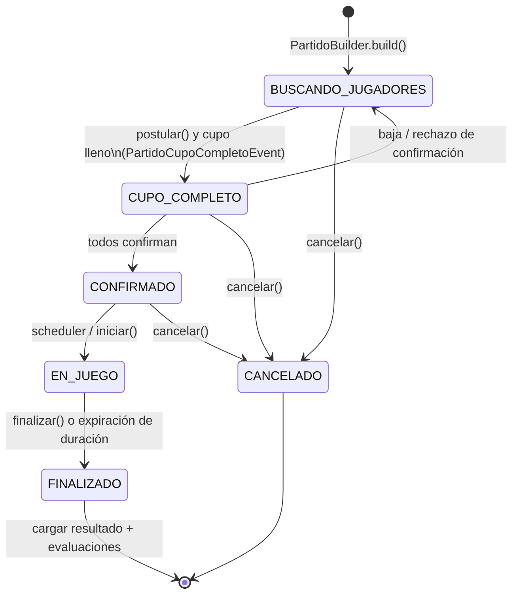
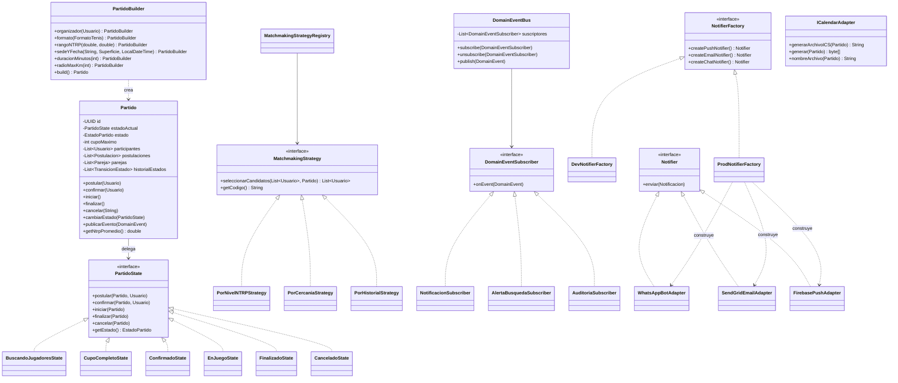
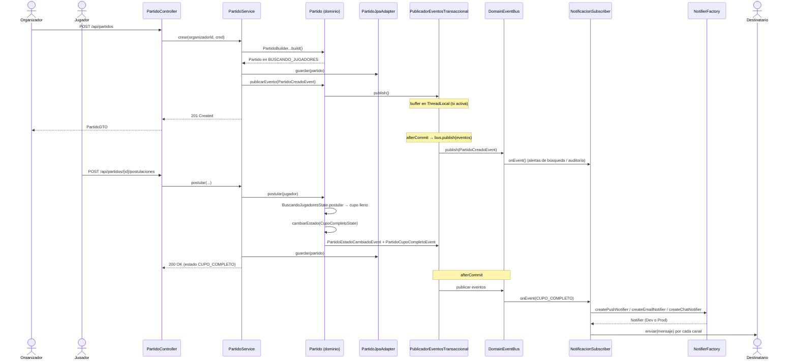
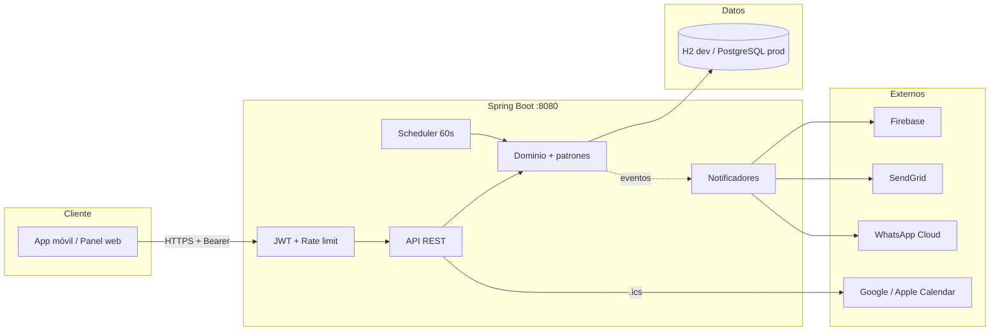
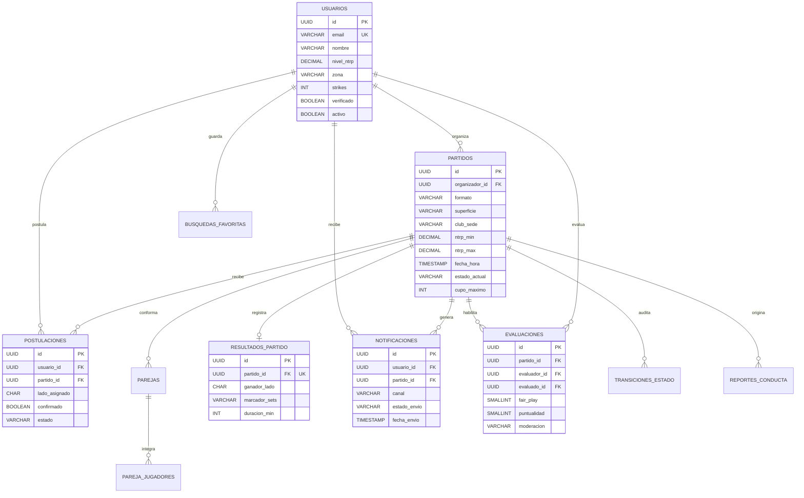

# Diagramas — TenisSkillGames

## 1. Ciclo de vida del Partido (patrón State)

Transiciones denegadas (todas lanzan `IllegalStateException`, traducida a `409`):

- `BUSCANDO_JUGADORES` → `confirmar()`, `iniciar()`, `finalizar()`
- `CUPO_COMPLETO` → `iniciar()`, `finalizar()`
- `CONFIRMADO` → `postular()`, `finalizar()`
- `EN_JUEGO` → `postular()`, `confirmar()`, `cancelar()`
- `FINALIZADO` / `CANCELADO` → todas

## 2. Diagrama de clases (patrones)

## 3. Secuencia — crear → postular → confirmar → notificar

## 4. Despliegue lógico

## 5. DER

